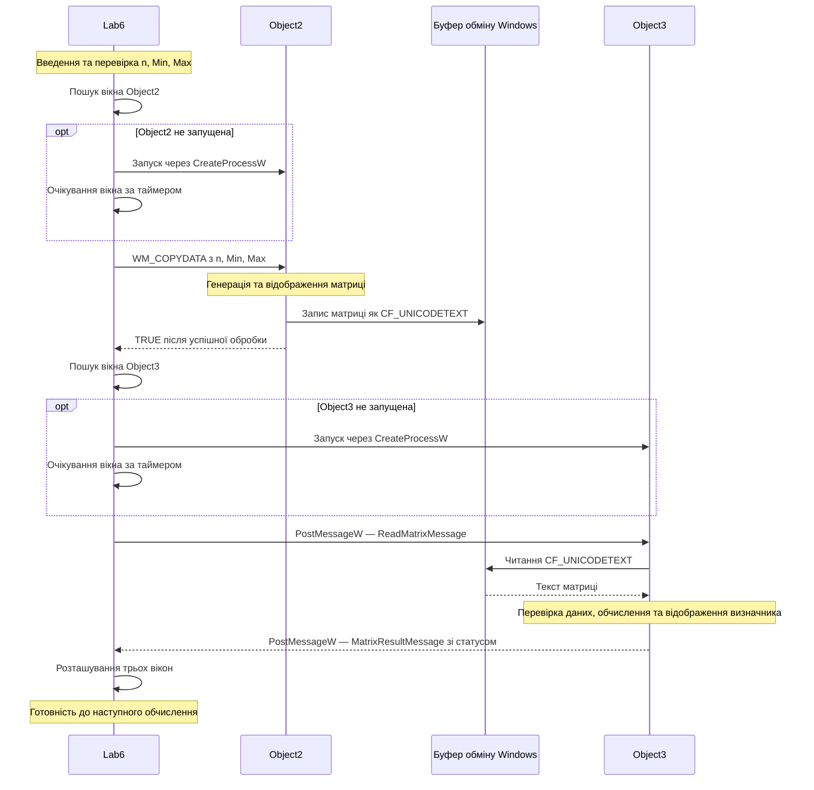

# Обмін повідомленнями в лабораторній роботі №6

Варіант 1: Ж mod 4 = 1.

Схема показує успішне виконання одного обчислення.

## Обробка помилок

- Неправильні параметри відхиляються в діалоговому вікні.
- Очікування відповіді на WM_COPYDATA обмежене 3 секундами.
- Очікування запуску Object2 обмежене 10 секундами.
- Для Object3 встановлено спільний ліміт очікування запуску та результату — 10 секунд.
- Якщо запущена Lab6 допоміжна програма не створила потрібне вікно вчасно, виконується спроба скасувати її запуск.
- Object3 запускає обробку тільки після підтвердження успішного запиту до Object2.

## Закриття

Після запиту на закриття Lab6 очікує завершення поточного
запиту або обробки тайм-ауту. Під час знищення головного
вікна допоміжним вікнам надсилається WM_CLOSE.